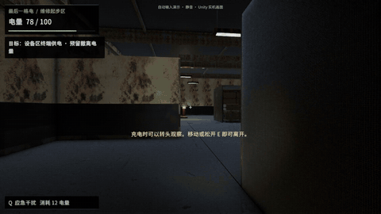

# 最后一格电 · Last Cell of Power

一个使用 Unity 6 制作的第一人称潜行逃生游戏。你需要在废弃仓库中管理剩余电量，利用遮挡、远程诱导、临时隔离门和应急干扰避开巡检机器人，为终端供电并抵达出口。

当前发布版本是**战术信息与操作反馈完善版**。2026-11-14，项目使用者反馈“人工验证无误”，并批准上传与公开。本仓库保留既有开发笔记和历史，现已加入可打开的完整 Unity 工程。

## 游戏演示

[](https://github.com/yq6666-66/unity-last-cell-of-power/releases/download/tactics-polish-2026-11-14/gameplay-route-auto-20261115.mp4)

上图是当前版本自动输入路线的9秒节选，展示设备接近、诱导、Q干扰与撤离。视频为Unity引擎画面、静音，使用真实角色控制器；不是人工首通录像。

| 演示 | 内容 |
| --- | --- |
| [完整逃生视频 · 约23秒](https://github.com/yq6666-66/unity-last-cell-of-power/releases/download/tactics-polish-2026-11-14/gameplay-route-auto-20261115.mp4) | 充电 → 诱导 → Q干扰 → 终端供电 → 出口 → 结果 |
| [仓库连接口镜头 · 12秒](https://github.com/yq6666-66/unity-last-cell-of-power/releases/download/tactics-polish-2026-11-14/warehouse-portals-camera.mp4) | 墙面修复基线的受控相机连续镜头，展示通道、墙体与北出口 |
| [10张截图与录制说明](docs/demos/README.md) | 双机器人、场景、诱导响应、门取消、双威胁、帮助与结算 |

## 下载试玩

打开 [Releases](https://github.com/yq6666-66/unity-last-cell-of-power/releases/tag/tactics-polish-2026-11-14)，下载 `ChapterTacticsPolish-Windows.zip`，全部解压后运行 `LastCellOfPower.exe`。这是 Windows x64 Development 包；不要只复制 exe。

| 操作 | 按键 |
| --- | --- |
| 移动与观察 | WASD、鼠标 |
| 充电、终端和环境装置 | E |
| 对最近有效威胁进行单体干扰 | Q |
| 暂停与帮助 | Esc |
| 结局后重新开始 | R |

## 当前内容

24×24米四区仓库形成环路，两台锈损机器人分别巡逻。目标是补电、给终端供电、到达出口；诱导器和临时门均是可选手段。N01/N02把控制台与远端扬声器配对，显示真实的历史响应数；S01解释门口占用或关门取消，并显示是否保留次数。安全接近教学与三张帮助卡介绍工具限制。

本轮保留原速度、电量、次数、碰撞导航和目标。世界牌、HUD与反馈只读取实际状态，不显示隐藏机器人的位置。原单房、四区、单机器人、美术、双机器人及墙面修复场景随源码保留。

## 用 Unity 打开

1. 使用 **Unity 6000.3.28f1**，为Windows构建安装对应的Windows模块。
2. 克隆本仓库，或解压Release中的完整源码包；在Unity Hub中添加包含`Assets`、`Packages`、`ProjectSettings`的工程根目录。
3. 等待依赖和资源导入，打开 `Assets/ChapterTacticsPolish/Scenes/WarehouseTacticsPolish.unity`。
4. 点击Play，在Game窗口选择开始。其他旧场景是历史基线，当前交付以这个场景为准。

项目使用URP 17.3.0、Input System 1.20.1、AI Navigation 2.0.16，以及清单中锁定的依赖。原始资源与`.meta`一并提交，无需Git LFS；`Library`由Unity本地生成。没有网络服务器。

## 构建和检查

可以在Unity Build Profiles中添加当前场景并选择Windows x64构建。若使用工程现有Unity CLI和Pipeline命令，在工程根目录执行：

```powershell
unity run . --command 'polish inspect' --no-tail --timeout 420 --format json
unity run . --command 'polish verify' --no-tail --timeout 420 --format json
unity run . --command 'polish presentation' --no-tail --timeout 420 --format json
unity run . --command 'polish route' --no-tail --timeout 420 --format json
unity run . --command 'polish build' --no-tail --timeout 900 --format json
```

后台检查覆盖10组状态/兼容、2组呈现及一条真实控制器的合成输入路线。Windows构建为0错误、0警告。RTX 4060 Laptop GPU的1080p固定机位渲染加同步回读采样平均5.24ms、P956.09ms；这不是正常游玩FPS。人工验证是使用者的总体反馈，不冒充逐项实验记录。

| 文档 | 内容 |
| --- | --- |
| [本版说明](Documents/ChapterTacticsPolish-Delivery.md) | 变化、配置、复现入口与运行方式 |
| [人工验证记录](Documents/ChapterTacticsPolish-UserValidation.md) | 本轮总体反馈与公开发布授权 |
| [检查汇总](Evidence/ChapterTacticsPolish/Acceptance.md) | 工程证据、已知检查限制及分层结论 |
| [配置源码](Assets/ChapterTacticsPolish/Runtime/TacticalReadabilityProfile.cs) | 设备映射、文案和呈现参数 |
| [变更记录](CHANGELOG.md) | 项目演进 |
| [原开发笔记](last-cell-dev-notes/README.md) | 原仓库保留的经验与参考资料 |

编辑器检查退出阶段有一项已留档的Input System清理断言，开发包图形探针未出现相应运行时异常。原始日志和本机备份不公开，随仓库提供检查摘要；历史文档中的“待人工验证”描述当时状态，最新反馈以人工验证记录为准。

## 素材与许可

本轮没有新增外部素材。已使用的CC0素材来源、作者和哈希保存在 `Assets/ChapterOneArt` 的来源文件与 `Licenses` 中；Noto与Liberation字体保留OFL许可，EmojiOne保留署名。Windows包的`ThirdPartyNotices`携带相应文件。第三方材料按各自许可使用；公开仓库不改写这些许可，也没有另行给原创代码和原创资产添加许可证。

## 开发方式

每次开发前核对 [game-development-plugins](https://github.com/yq6666-66/game-development-plugins)，按当前任务读取相关流程。本版采用提交 `8693e66d50f40b70f95fec3f77f3a0322ef08eb3`。首次方案确认只用于首次开工/接手，后续在已授权范围内按任务推进；集中后台检查，最终同一版本集中试玩。
