# 游戏演示与画面集

更新于2026-11-15。当前游戏内容对应战术信息与操作反馈完善版，玩法源码基线为 `cbd5cb32f6b223a7a92fea67a031c55a92f19a7d`。本次只补充演示媒体和文档，已发布Windows包保持不变。

## 视频

[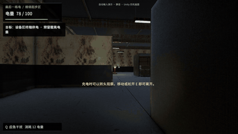](https://github.com/yq6666-66/unity-last-cell-of-power/releases/download/tactics-polish-2026-11-14/gameplay-route-auto-20261115.mp4)

| 视频 | 时长和格式 | 观看内容 |
| --- | --- | --- |
| [完整逃生演示](https://github.com/yq6666-66/unity-last-cell-of-power/releases/download/tactics-polish-2026-11-14/gameplay-route-auto-20261115.mp4) | 约23秒，1280×720，MP4/H.264，静音 | 实际控制器行走、充电、远端诱导、一次Q、终端供电、撤离与结果 |
| [连接口与出口镜头](https://github.com/yq6666-66/unity-last-cell-of-power/releases/download/tactics-polish-2026-11-14/warehouse-portals-camera.mp4) | 12秒，1280×720，MP4/H.264，静音 | 同地图墙面修复基线的前进、后退、横移和转头镜头 |

完整逃生片的约0—7秒是开场与充电，7—10秒接近并启动诱导，11—14秒使用Q并给终端供电，14—19秒撤离，结尾停留在结果界面。精确状态与录制来源见[媒体清单](../../media/demos/manifest.json)。

## 环境与机器人

| 维修起步区 | 供电终端 |
| --- | --- |
| 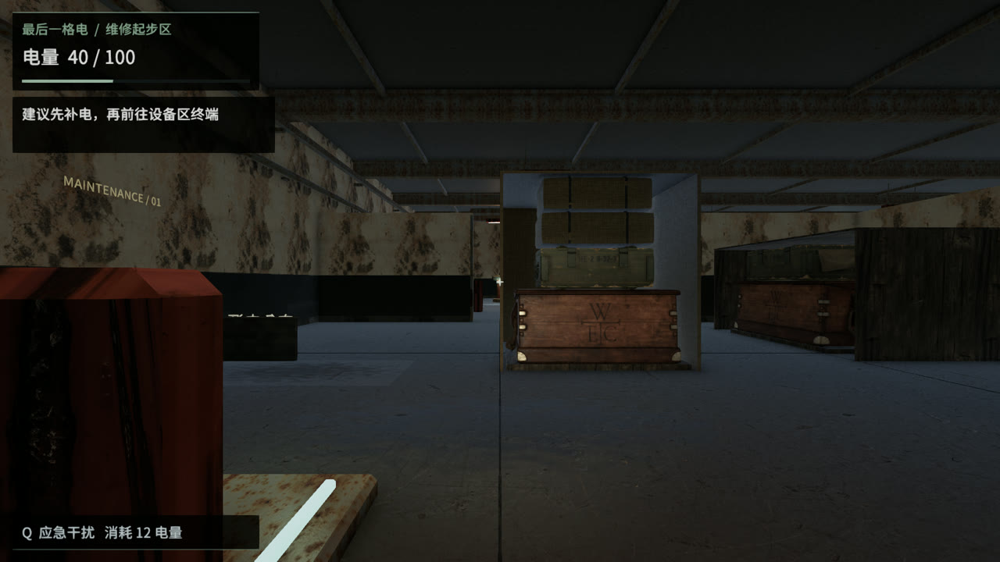 | 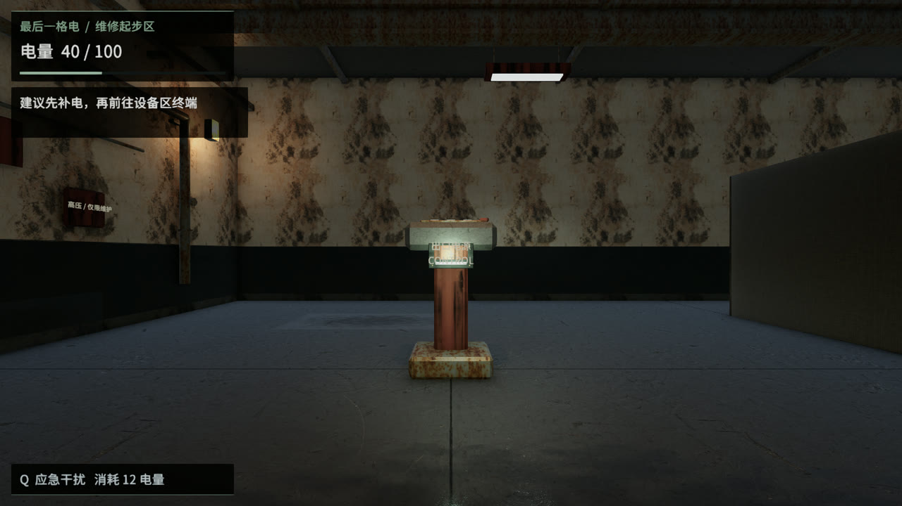 |

| 01号巡检机 | 02号巡检机 |
| --- | --- |
| 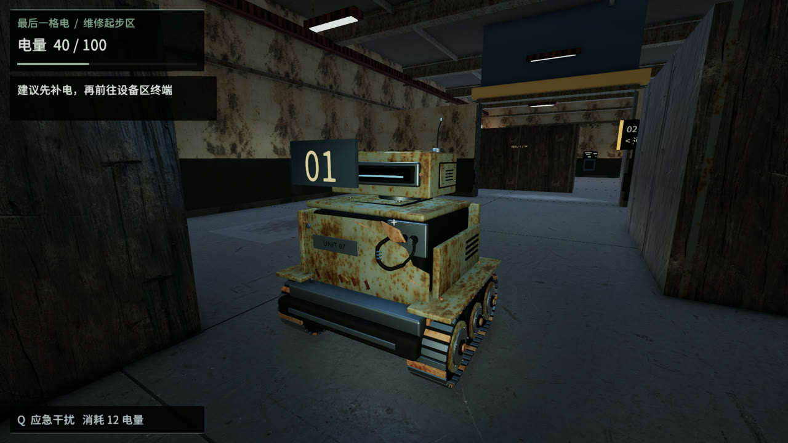 | 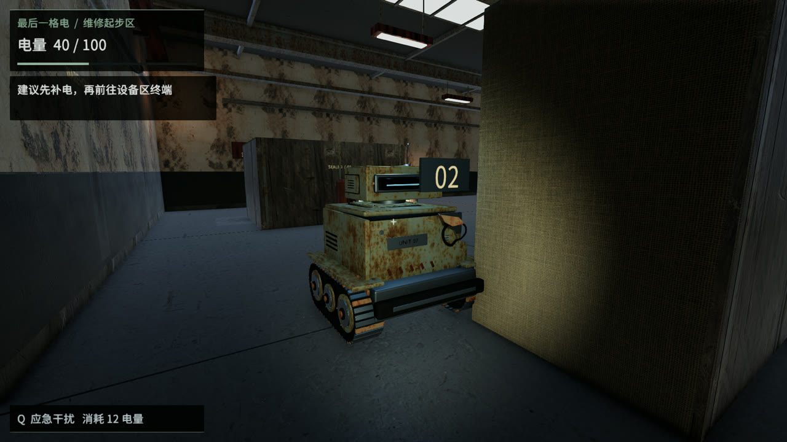 |

| 北侧出口 | 双威胁与闭锁倒计时 |
| --- | --- |
| 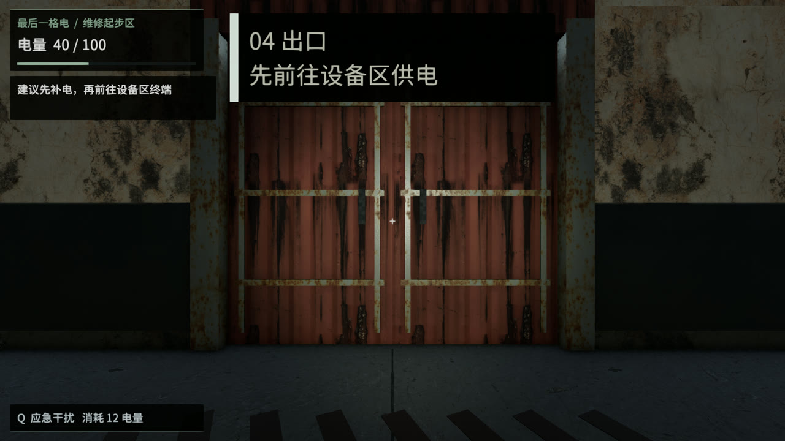 | 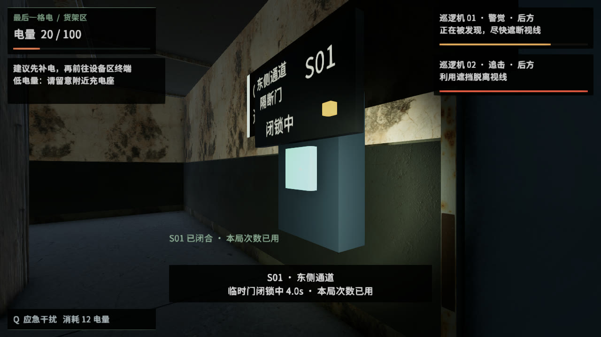 |

## 设备反馈与界面

| 诱导装置：真实接受后的累计响应 | 隔离门：占用取消与次数保留 |
| --- | --- |
| 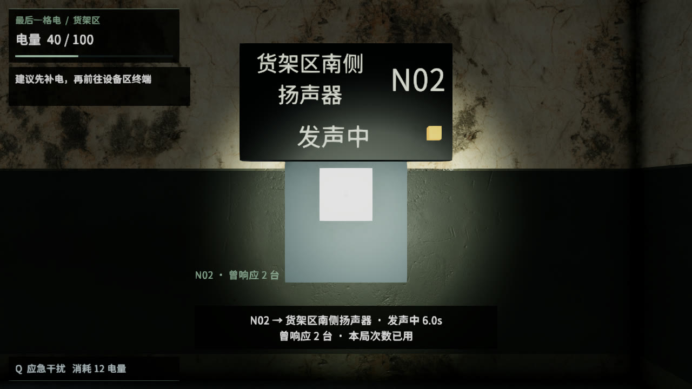 | 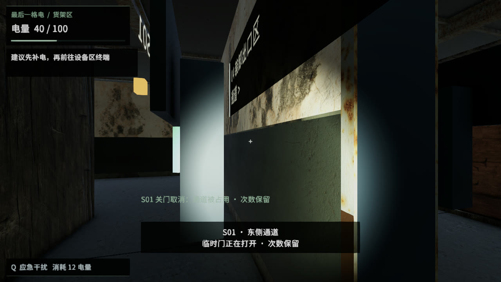 |

| Q、诱导与门的帮助卡 | 本次自动路线的实际结果 |
| --- | --- |
| 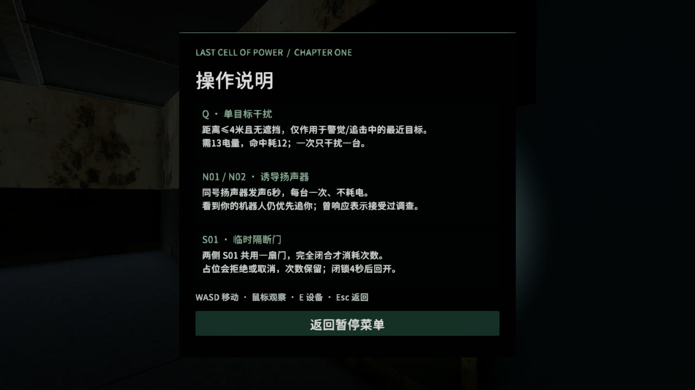 | 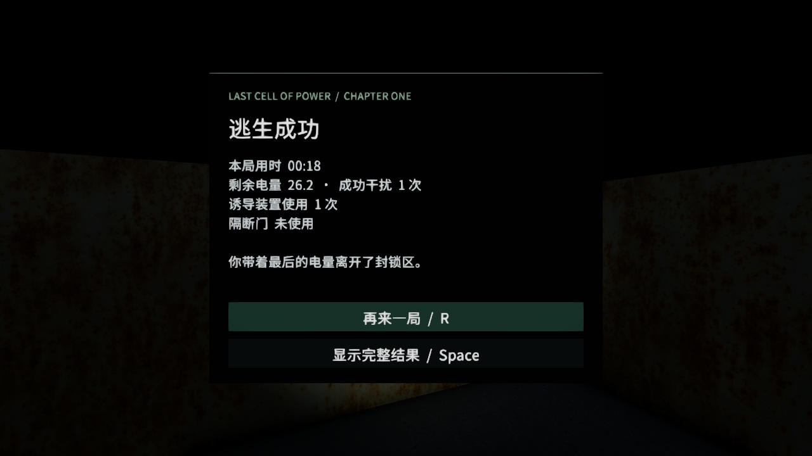 |

## 录制方式

完整路线使用现有合成键盘/鼠标驱动、模拟焦点及真实CharacterController和NavMeshAgent；玩家和敌人没有位置设置或瞬移。录制观察器仅读取相机、HUD和结果；为离屏捕获临时将Canvas切到Camera模式，结局使用已有的跳过淡入操作显示完整统计。本次实际结果为逃脱，诱导一次、Q一次、隔离门未使用。自动路线的用时不是人工首通时间。

仓库镜头来自此前墙面修复版的连续渲染序列，使用受控相机且玩法冻结；它不是本版正常玩家操作。五张场景/机器人图来自本版Windows开发包的固定机位；诱导、门、双威胁和帮助图来自受控呈现检查；结算图来自本次自动路线。固定镜头图中的区域HUD仍跟随玩家所在区域，不表示相机已移动玩家。

所有内容都是项目引擎输出，没有使用生成式画面替换游戏内容。视频添加了录制类型说明，截图只做尺寸和压缩转换。MP4编码帧率与GIF采样率不是运行性能测试。

两段MP4已做解码检查，并抽帧核对充电、响应、干扰、场景和结果。媒体SHA-256见[Demo-SHA256SUMS.txt](https://github.com/yq6666-66/unity-last-cell-of-power/releases/download/tactics-polish-2026-11-14/Demo-SHA256SUMS.txt)。
